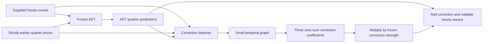

# AET plus graph residual correction

This is an integrated second-stage model:

**predicted quarters = AET quarters + selected strength × GNN-predicted AET error**

It learns actual-minus-AET quarter-price errors. Unlike the previous convex blend, the graph
does not independently reconstruct the whole PCHIP residual. AET's predicted shape is an input
to the correction, alongside hourly geometry and strictly earlier quarter-price history.
The original AET code, configurations and weights are unchanged.

## Why out-of-fold errors matter

AET's training-set errors can be artificially small and have a different structure from its
errors on new dates. We therefore fit a sequence of chronological teacher models:

| AET fit | Predictions used as correction-training examples |
| --- | --- |
| Through October 31, 2025 | November 2025 |
| Through November 30, 2025 | December 2025 |
| Through December 31, 2025 | January 2026 |
| ... | ... |
| Through July 31, 2026 | August 2026 |

Every teacher uses the same frozen official AET recipe and only earlier dates. These are
time-based out-of-fold (OOF) predictions, not random cross-validation. Earlier target-month
actuals may become known history for later dates, as allowed by the daily challenge replay.
No target-day quarters are prediction features.

For example, the January outer evaluation uses a December-end AET model. Its correction
network trains only on November–December OOF errors. The January labels train neither component.
The February correction may then use the earlier January OOF errors. Feature scaling is fitted
inside each correction-training window. Both teacher and outer-fold cutoffs are exported.

This protects chronological fitting boundaries. The AET recipe and development dates were
already studied, so it does not create an independent test or erase earlier model selection.

## Small graph and controlled comparison

- Hidden width 16, one temporal convolution and one directed attention/message step; starts from scratch.
- The output head starts at zero, giving the initial AET prediction unchanged.
- Three coefficients decode through the zero-sum basis. Corrections have zero hourly mean;
  final prices are recentered in float64 and validated. Negative prices remain valid.
- Local prediction path, dropout, weight decay and correction-magnitude regularization limit overfitting.
- Inputs: local hourly geometry/calendar/history features, AET shape coefficients, AET adjustment
  versus PCHIP, days since teacher fitting, and teacher training-day count.
- Training minimizes quarter-price L1 plus a small magnitude penalty, for 80 fixed epochs. No
  scoring-target early stopping. Training teacher age varies across monthly OOF examples; outer
  evaluation remains day 19 to month-end, matching previous comparisons.
- A matched **no-message** network uses the same features, width, loss and training windows.
  AET already incorporates cross-zone features, so this control isolates the extra graph messages;
  it does not eliminate all cross-zone information from the combined system.

This correction model is deterministic. The previous Bayesian model's uncertainty intervals
do not apply to it. The graph links remain statistical dependencies between four anonymous
zones, not identified countries, physical trade flows or causal effects.



## Selection and evaluation

The bounded plan is written before training. January–May outer folds select strengths from
**0, 0.1, 0.25, 0.5, 1** separately for graph and no-message variants. Zero means AET only.
The lowest selection MAE chooses the candidate; ties favor smaller correction strength.
Those choices are written before generating June–August OOF outputs or scoring confirmation.
Both variants are then evaluated on June–August without retuning, with AET and the previous
fixed blend as references. All four zones carry equal weight.

Raw correction results (strength 1) are disclosed alongside each locked selected strength.
The existing promotion gate requires >=0.5% MAE improvement versus AET, wins in at least two of
three confirmation months, and no zone >2% worse. No incumbent is automatically replaced.
September and October are excluded from this integration experiment.

A subsequent user-requested **frozen September 19–30 assessment** scores graph correction
**5.06125** and no-message correction **5.05213**, versus AET **5.04427 EUR/MWh**. Both retain
strength 0.25 and were neither retrained nor retuned. Their small development improvements do not
carry over to this September block. [Separate assessment](results/aet_residual_graph_september/assessment_results.md).

See [all trial results and cutoffs](results/aet_residual_graph_study/residual_results.md).

## Run and reproduce

From the ApplePi root, using the existing `requirements.txt` environment:

```bash
# Generate chronological OOF teachers, fit/evaluate corrections and save integrated artifacts.
# The output directory must be new.
.venv-mae/bin/python -m Paola_models.residual_study \
  --train Data/train_prices_15min.csv \
  --out Paola_models/results/aet_residual_graph_study

# Inference with the separately saved integrated graph artifact.
.venv-mae/bin/python -m Paola_models.cli infer \
  --model Paola_models/results/aet_residual_graph_study/artifact_graph_through_august \
  --hourly path/to/new_hourly.csv --history path/to/earlier_history.csv \
  --out path/to/new_predictions.csv
```

`--history` is optional; missing history uses frozen training history and the learned missing-value
handling. All 24 hourly values for all four zones are required. Target dates must follow August 31
for these research snapshots. Inference does not refit AET, the graph, scaling or correction strength.

To retrain just the correction using the saved OOF bundle and selected recipe:

```bash
.venv-mae/bin/python -m Paola_models.residual_train \
  --train Data/train_prices_15min.csv --train-end 2026-08-31 \
  --oof Paola_models/results/aet_residual_graph_study/oof_through_2026-08-31.npz \
  --aet-model AET-HACKATHON/artifacts_september_assessment \
  --recipe Paola_models/results/aet_residual_graph_study/selection_before_confirmation.json \
  --candidate graph --out Paola_models/artifacts/NEW_residual_graph
```

Generating the OOF teachers is a training step, never an inference step. The full study command
recreates them from the official local price file without external data or pretrained weights.
The final artifact copies the exact August-cutoff AET checkpoint and saves the correction separately.
The no-message artifact is independently loadable through the same inference CLI.

## Diagnostics and limitations

The result directory contains every selection trial, monthly/zone scores, all outer-fold
predictions, chronological teacher outputs, and provenance ledgers. Confirmation graph attention
and edge-removal MAE changes are saved for later visualization. Positive removal delta means
masking that source→receiver edge hurt this fitted model; negative means masking helped.
Effects are conditional on the selected correction strength, including zero if correction was rejected.

Only one seed is used in this bounded first integration. Small gains need multi-seed and
predeclared outer-window checks before claiming robustness. OOF teacher quality changes as the
training set grows, which can shift the correction target distribution. Explicit teacher age and
training-day count help describe that shift but cannot guarantee generalization. Complexity must
earn a measured benefit over the already strong baseline.
