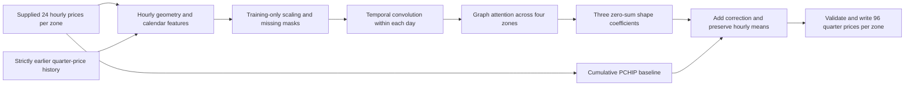

# Paola's temporal graph model

An isolated experimental spatiotemporal graph neural network, trained from scratch on the
official challenge price file. Existing `AET-HACKATHON` models, artifacts, and configs are unchanged.
Run all commands below from the **ApplePi root**.

**First experiment:** TGNN **4.2611 EUR/MWh** versus LightGBM **3.9479**, on the same eight
Jan–Aug folds. TGNN was **7.93% worse** and won **0/8** folds; keep LightGBM as the incumbent.
See [the comparison and monthly results](results/tgnn_80epochs/results.md).
This is an implemented and tested research candidate, not an improved replacement.

## What it does

The input tensor is `[days, 4 zones, 24 hours, features]`. Each hour has a four-node zone graph;
all zones may exchange messages through learned attention. A temporal convolution propagates
information between neighboring hours of the **same supplied daily curve**. Two residual blocks
combine these operations. Connections express learned statistical relationships, not assumed
physical transmission lines or identified countries.

The network predicts three coefficients in the existing zero-sum slope/curvature/zigzag basis.
The decoded correction is added to cumulative PCHIP, then recentered in float64 to eliminate
rounding drift. Thus the four predicted quarter prices retain the supplied hourly mean.
The loss is **L1 on decoded quarter-price corrections**, equivalent to price MAE when added to
the fixed baseline; it is not an independent coefficient-MAE objective.



This is a small daily spatiotemporal graph network, not a streaming temporal-event graph model.
Temporal dependence comes from within-day convolutions and prior-date features, not hidden
state carried between successive evaluation dates. Bidirectional within-day processing is
permitted because the entire target-day hourly curve is supplied together.

## Inputs and challenge constraints

- Reuses the existing official-schema checks, cumulative PCHIP, basis, and calendar history code.
- Features: hourly level, local slopes/curvature, daily amplitude, relative level, hour/calendar,
  baseline coefficients, exact 1-/7-day historical coefficient lags and 7-/28-day means/counts.
- Four one-hot zone identifiers; no pretrained representations or external weights.
- No pairwise cross-zone feature columns: the graph learns cross-zone interactions. Temporal-only
  mode disables that message path for a controlled architecture comparison.
- Feature means/scales are fitted **only on the training fold**. Missing values use the frozen
  training mean plus a missing indicator; normalized magnitudes are clipped to [-8, 8].
- Each history lookup reads only dates strictly before its target. Exact calendar lags preserve
  missing DST dates. Target/future quarter prices cannot enter prediction features.
- Supplied target-day hourly values are allowed; target-day quarter prices are labels only.
- No external data, October evaluation data, pretrained models, or network use during inference.
- No inference-time fitting, normalization updates, calibration, or hidden state adaptation.
- All 24 hours of all four zones are required per target date. Incomplete or nonfinite inputs fail
  clearly. The graph path currently has **no automatic fallback** if model loading/prediction fails.
- Output is validated before serialization and after CSV reload: finite unique quarter keys and
  hourly mean tolerance <=0.0001 EUR/MWh. Do not clip negative price predictions.

The training helper accepts only official-period cutoffs; backtesting stops before September.
September was already EDA-exposed and is not reopened for selecting this model. The repository's
[prior provenance disclosure](../AET-HACKATHON/docs/PROVENANCE.md) still applies: this new experiment
does not establish competition eligibility for the complete project history.

## Environment

This run uses the existing local `.venv-mae` environment: Python 3.13.5, PyTorch 2.9.1, NumPy 2.1.3,
pandas 2.2.3, SciPy 1.15.3, LightGBM 4.7.0, PyYAML 6.0.2. It is CPU-only, with four threads and
deterministic PyTorch operations. Exact cross-platform reproducibility is not guaranteed.
For a fresh environment, install `Paola_models/requirements.txt` before going offline.

## Evaluate the fixed recipe

```bash
.venv-mae/bin/python -m Paola_models.cli backtest \
  --train Data/train_prices_15min.csv \
  --out Paola_models/results/tgnn_80epochs
```

Eight rolling-origin folds train through the preceding month-end and score day 19 to month-end
in January–August 2026. Earlier scoring dates can become historical inputs on later dates, while
the fold weights stay fixed. No scoring-date target is used for early stopping or architecture selection.
The recipe uses hidden width 32, two blocks, dropout 0.1, AdamW, fixed 80 epochs, seed 42.

The output compares TGNN, the unchanged LightGBM recipe, flat repetition, PCHIP, and fixed slope x 2
on identical observations. The official score averages daily MAE within each zone, then the four
zones equally. The report checks the incumbent promotion gate: >=0.5% gain, wins on >=6/8 folds,
and no zone more than 2% worse. All trials must be disclosed; development comparisons are not
independent final-test performance. Complexity must earn its place through measured benefit.

Optional temporal-only comparison, with identical features/epochs and graph messages disabled:

```bash
.venv-mae/bin/python -m Paola_models.cli backtest \
  --out Paola_models/results/temporal_only_80epochs --no-graph
```

Output folders cannot already exist; choose a new folder rather than overwriting a prior result.
Fold models are temporary except `last_fold_model/`, which is saved through July for Aug replay.

## Train a separate artifact

```bash
.venv-mae/bin/python -m Paola_models.cli train \
  --train Data/train_prices_15min.csv --train-end 2026-08-31 \
  --out Paola_models/artifacts/through_august
```

The output contains `weights.pt`, `scaler.npz`, `history.npz`, and `manifest.json` with settings,
training range, feature schema, epoch training losses, parameter count, and library versions.
Use a new output directory for each training run. Training loss is not held-out performance.
For a justified final full-package fit, explicitly set `--train-end 2026-09-30`; that artifact must
never be used to claim held-out September performance. No full-year graph artifact is created automatically.

`artifacts/through_august/` has been created by the command above with the fixed 80-epoch recipe.
It is separate from the fold checkpoints and all existing AET artifacts. Its training loss is not
a new assessment score; no September targets are scored to select or promote it.

## Offline inference

```bash
.venv-mae/bin/python -m Paola_models.cli infer \
  --model Paola_models/artifacts/through_august \
  --hourly test_hourly.csv --history history_15min.csv \
  --out Paola_models/predictions.csv
```

Input/output CSV schemas match the existing challenge pipeline. New target dates must follow
the model training cutoff. Supplied history overrides stored training history, with all lookups
sliced before each predicted date. `--history` may be omitted to use saved training history.
Output files are never overwritten silently. No model weights or scalers change during inference.

This folder reuses sibling `AET-HACKATHON/aet` modules: it is not a standalone distribution.
A submission bundle would need those shared modules, dependencies, artifacts, commands,
and provenance documentation. No deployment or submission is performed here.

## Tests

```bash
.venv-mae/bin/python -m pytest -q Paola_models/test_temporal_graph.py
.venv-mae/bin/python -m pytest -q AET-HACKATHON/tests
```

Synthetic prices are used only for software tests. Tests cover graph/temporal information flow,
zero-sum reconstruction with negative prices, target/future-history poisoning, exact calendar gaps,
missing history, artifact roundtrip, no inference updates, deterministic fitting, invalid inputs,
and rejected October training. Real development scores use only the official CSV.

Verification from this implementation: **9 new tests passed**, and **54 existing AET tests passed**.
The training and inference CLI smoke run produced 384 rows with maximum hourly mean error
2.51e-11 EUR/MWh. The two-epoch model under `results/cli_smoke_model/` exists only for that interface
check; it is not a scored candidate or the August artifact. The 80-epoch development run checked
every day's outputs and recorded unchanged hashes of both original artifact directories.
