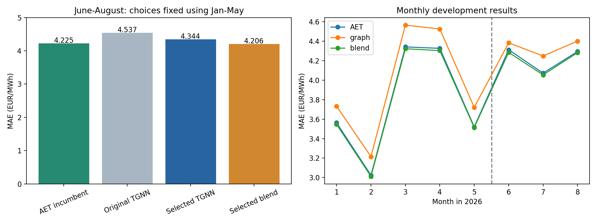

# AET-informed graph optimization

Selection used January–May only. Before scoring June–August, the choice was locked to
**compact_local**, with graph blend weight **0.25**. The blend combines AET and graph prices;
it is not a pure graph model. Weight zero means AET only, and one means graph only.

## Every selection trial

| candidate | search_MAE | seconds |
| --- | --- | --- |
| original | 4.0864 | 0.0000 |
| aet_features | 4.1998 | 48.9835 |
| aet_loss_shrink | 4.0964 | 53.1485 |
| compact_local | 3.9695 | 27.1759 |

| graph_weight | search_MAE |
| --- | --- |
| 0.0000 | 3.7726 |
| 0.1000 | 3.7605 |
| 0.2500 | 3.7573 |
| 0.5000 | 3.7877 |
| 1.0000 | 3.9695 |

## Stage scores (EUR/MWh)

| stage | method | MAE |
| --- | --- | --- |
| confirmation_Jun_Aug | AET incumbent | 4.2246 |
| confirmation_Jun_Aug | Original TGNN | 4.5369 |
| confirmation_Jun_Aug | Selected TGNN | 4.3440 |
| confirmation_Jun_Aug | Selected blend | 4.2057 |
| selection_Jan_May | AET incumbent | 3.7726 |
| selection_Jan_May | Original TGNN | 4.0864 |
| selection_Jan_May | Selected TGNN | 3.9695 |
| selection_Jan_May | Selected blend | 3.7573 |



## Monthly scores

| fold | stage | AET | graph | blend |
| --- | --- | --- | --- | --- |
| m2026_01 | selection_Jan_May | 3.5632 | 3.7334 | 3.5468 |
| m2026_02 | selection_Jan_May | 3.0235 | 3.2152 | 3.0117 |
| m2026_03 | selection_Jan_May | 4.3423 | 4.5666 | 4.3234 |
| m2026_04 | selection_Jan_May | 4.3275 | 4.5259 | 4.3042 |
| m2026_05 | selection_Jan_May | 3.5203 | 3.7210 | 3.5141 |
| m2026_06 | confirmation_Jun_Aug | 4.3135 | 4.3839 | 4.2861 |
| m2026_07 | confirmation_Jun_Aug | 4.0725 | 4.2491 | 4.0547 |
| m2026_08 | confirmation_Jun_Aug | 4.2948 | 4.4020 | 4.2826 |

## June–August zone scores

| market_id | graph_error | blend_error | aet_error |
| --- | --- | --- | --- |
| ZONE_0 | 3.3644 | 3.1696 | 3.1845 |
| ZONE_1 | 5.0615 | 4.8978 | 4.9230 |
| ZONE_2 | 4.2033 | 4.1736 | 4.1987 |
| ZONE_3 | 4.7468 | 4.5821 | 4.5923 |

The locked blend changes confirmation MAE by -0.45% versus AET, wins 3/3 folds,
and has worst-zone degradation -0.22%. Confirmation gate passed: **False**
(>=0.5% gain, >=2/3 folds won, no zone >2% worse). No incumbent artifact/config was replaced.
Selection scores are optimistic after candidate comparisons. All development months were inspected
previously: this confirmation is not an untouched test. September and October were excluded.

## Changes tested

- Explicit AET cross-zone spreads/slopes in addition to learned graph messages.
- Coefficient L1 and fixed 0.8 correction shrinkage, assessed by quarter-price MAE.
- A smaller one-block graph with a direct local linear path to preserve magnitude information.
- A predeclared convex blend grid, selected only on Jan–May predictions.

`plan.json` was written before training; `selection_before_confirmation.json` before confirmation.
No candidates or weights were added after viewing confirmation. Each scaler/model uses only
earlier training dates, with strictly earlier-date history. Graph and blend outputs were validated
after CSV reload. Original graph checkpoints stay loadable using the old default configuration.

## Artifacts and reproduction

`selected_graph_through_august/` is the new graph checkpoint. If 0<graph weight<1,
`selected_blend_through_august/` contains the graph plus a copy of the official-data August-cutoff
AET checkpoint. Inference uses no fitting, calibration, or outside-trained weights.

```bash
../.venv-mae/bin/python -m Paola_models.cli infer --model PATH_TO_ARTIFACT \
  --hourly test_hourly.csv --history history_15min.csv --out NEW_OUTPUT.csv
```

Run from the isolated Paola checkout. The CLI recognizes either artifact type. Row comparisons
are in `selected_predictions.csv`. `summary.json` records validation, gate checks, source data hash,
and unchanged AET artifact hashes. This is research, not automatic promotion or eligibility certification.
