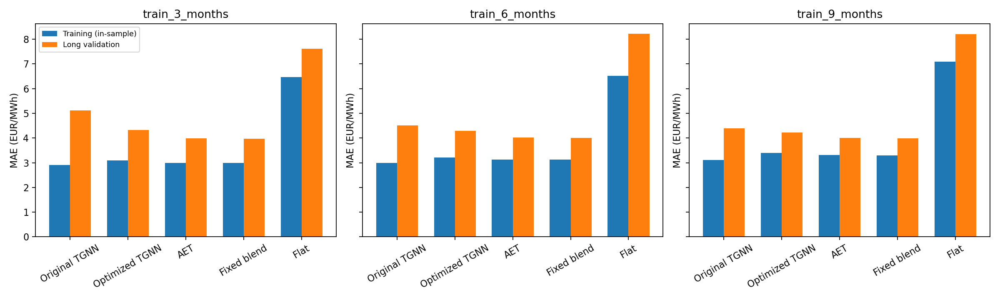
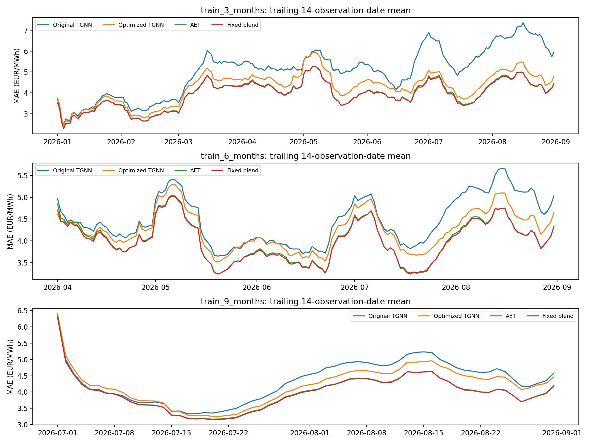

# Shorter training and longer validation: generalization check

This test keeps both neural recipes, the AET recipe, and the **.25 graph / .75 AET blend weight fixed**.
No early stopping, hyperparameter search, blending recalibration, September scoring, or model
promotion occurred. Each fitted model stays fixed for its entire validation window.

[Read the main findings and recommendation](findings.md).

## Splits declared before fitting

| scenario | training_start | training_end | training_dates | validation_start | validation_end | validation_dates | validation_quarter_prices |
| --- | --- | --- | --- | --- | --- | --- | --- |
| train_3_months | 2025-10-01 | 2025-12-31 | 91.0000 | 2026-01-01 | 2026-08-31 | 242.0000 | 92928.0000 |
| train_6_months | 2025-10-01 | 2026-03-31 | 180.0000 | 2026-04-01 | 2026-08-31 | 153.0000 | 58752.0000 |
| train_9_months | 2025-10-01 | 2026-06-30 | 271.0000 | 2026-07-01 | 2026-08-31 | 62.0000 | 23808.0000 |

The longest split validates every available January–August day rather than just the 19th onward.
Scenarios overlap; never pool their predictions as independent validation cases. There are
242 distinct validation dates overall, and all four zones have equal weight.

## In-sample versus out-of-sample MAE (EUR/MWh)

| scenario | method | training | validation_daily_history | validation_minus_training | validation_reduction_vs_flat_pct |
| --- | --- | --- | --- | --- | --- |
| train_3_months | AET | 2.9928 | 3.9907 | 0.9980 | 47.5486 |
| train_3_months | Fixed blend | 2.9878 | 3.9726 | 0.9847 | 47.7873 |
| train_3_months | Flat | 6.4678 | 7.6085 | 1.1407 | 0.0000 |
| train_3_months | Optimized TGNN | 3.0914 | 4.3266 | 1.2353 | 43.1338 |
| train_3_months | Original TGNN | 2.9052 | 5.1169 | 2.2117 | 32.7466 |
| train_6_months | AET | 3.1296 | 4.0263 | 0.8967 | 51.0292 |
| train_6_months | Fixed blend | 3.1250 | 4.0124 | 0.8874 | 51.1979 |
| train_6_months | Flat | 6.5104 | 8.2218 | 1.7114 | 0.0000 |
| train_6_months | Optimized TGNN | 3.2118 | 4.2842 | 1.0725 | 47.8921 |
| train_6_months | Original TGNN | 2.9951 | 4.5147 | 1.5195 | 45.0892 |
| train_9_months | AET | 3.3110 | 4.0036 | 0.6925 | 51.1535 |
| train_9_months | Fixed blend | 3.3037 | 3.9929 | 0.6892 | 51.2831 |
| train_9_months | Flat | 7.0909 | 8.1962 | 1.1052 | 0.0000 |
| train_9_months | Optimized TGNN | 3.3907 | 4.2260 | 0.8352 | 48.4401 |
| train_9_months | Original TGNN | 3.1148 | 4.3873 | 1.2726 | 46.4712 |

Training MAE is recomputed in inference/eval mode on fitted observations, with strictly earlier
history for each date. It is not the logged stochastic training loss. Validation is out of sample
relative to that scenario's weight/scaler fit. Day-ahead hourly references remain permitted inputs.



The gap alone does not prove overfitting. The target's flat-baseline error also changes with season,
and the earliest cutoffs see fewer seasonal regimes. Reduced relative improvement over flat,
large train/validation gaps, and sensitivity to cutoff together are warning signs. A good validation
result likewise cannot prove the absence of overfitting, particularly on previously inspected dates.

## Same July–August observations for every training size

| scenario | method | common_window_training_history_only | validation_daily_history |
| --- | --- | --- | --- |
| train_3_months | AET | 4.4953 | 4.3253 |
| train_3_months | Fixed blend | 4.4818 | 4.2950 |
| train_3_months | Flat | 8.1962 | 8.1962 |
| train_3_months | Optimized TGNN | 5.0032 | 4.6584 |
| train_3_months | Original TGNN | 5.8682 | 6.1340 |
| train_6_months | AET | 4.3967 | 4.1090 |
| train_6_months | Fixed blend | 4.3387 | 4.1013 |
| train_6_months | Flat | 8.1962 | 8.1962 |
| train_6_months | Optimized TGNN | 4.6413 | 4.4173 |
| train_6_months | Original TGNN | 4.6029 | 4.8273 |
| train_9_months | AET | 4.2538 | 4.0036 |
| train_9_months | Fixed blend | 4.1994 | 3.9929 |
| train_9_months | Flat | 8.1962 | 8.1962 |
| train_9_months | Optimized TGNN | 4.5930 | 4.2260 |
| train_9_months | Original TGNN | 4.8313 | 4.3873 |

This avoids comparing a winter validation window directly with a summer one. More training here
also means more recent training, so data quantity and recency are not causally isolated.
The `validation_daily_history` mode supplies only past observations, including earlier validation
dates, as frozen-rule inputs. It does not update weights, scalers, or the blend coefficient.
The `common_window_training_history_only` mode withholds all post-cutoff quarter prices; it is a
stress scenario, not the normal jury replay when fresh prior history is supplied.

## Does the blend help consistently?

| scenario | validation_dates | blend_minus_AET_MAE | gain_vs_AET_pct | fraction_dates_blend_better | paired_daily_block95_low | paired_daily_block95_high |
| --- | --- | --- | --- | --- | --- | --- |
| train_3_months | 242.0000 | -0.0182 | 0.4552 | 0.5537 | -0.0277 | -0.0097 |
| train_6_months | 153.0000 | -0.0139 | 0.3444 | 0.5817 | -0.0236 | -0.0046 |
| train_9_months | 62.0000 | -0.0106 | 0.2652 | 0.5806 | -0.0199 | -0.0006 |

Negative `blend_minus_AET_MAE` favors the blend. The 95% interval resamples paired daily
differences using seven consecutive observed-date blocks, preserving all zones together.
It is descriptive uncertainty under a block-resampling assumption, not proof of significance;
if the interval includes zero, a stable blend advantage is not established by this diagnostic.



## How to interpret this test

- The historical below-5 September score is specific to its original August-trained models and
  that September window. There is no promise of staying below 5 with much less training.
- The pure graph should be compared with AET on the exact same observations, and the blend with
  AET as well as the original graph. A blend can mask a weak neural component through its 75% AET share.
- Weights were frozen for up to eight months: degradation can reflect stale models, seasonal
  distribution shift, or overfitting. This experiment cannot uniquely identify their contributions.
- All months here have already featured in EDA or previous model development. New split boundaries
  do not make them an untouched independent test. Strong final claims still need organizer-held dates.

## Files and reproducibility

`training_vs_validation.csv`, `common_july_august_scores.csv`, `monthly_validation_scores.csv`,
`validation_zone_scores.csv`, and `blend_gain_uncertainty.csv` contain the summaries.
`daily_zone_scores.csv` retains every scenario/date/zone/method error.
`validation_predictions_vs_actual.csv.gz` contains every observed and predicted quarter value;
gzip saves disk space and pandas reads it directly. `plan.json` precedes fitting; `summary.json`
records data counts, timings, and unchanged-artifact hashes. Models were fitted only in memory,
and no existing checkpoint was replaced. Maximum hourly-average error: 1.14e-13 EUR/MWh.

```bash
.venv-mae/bin/python -m Paola_models.check_generalization --out Paola_models/results/NEW_generalization_check
```
