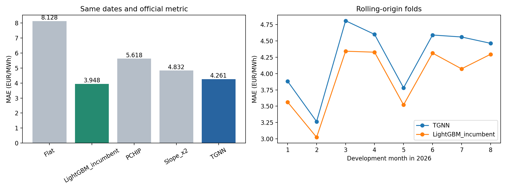

# Temporal graph model: first development results

**The graph model works, but does not improve the incumbent.** Its MAE is 4.2611 EUR/MWh,
7.93% worse than LightGBM. It wins zero of eight folds and fails the existing promotion gate.
Retain LightGBM for the current solution; the TGNN remains a separate research candidate.

| method | MAE | ZONE_0 | ZONE_1 | ZONE_2 | ZONE_3 |
| --- | --- | --- | --- | --- | --- |
| Flat | 8.1276 | 8.6808 | 10.1506 | 5.8485 | 7.8305 |
| LightGBM_incumbent | 3.9479 | 3.0769 | 4.6240 | 3.7022 | 4.3885 |
| PCHIP | 5.6185 | 5.2235 | 7.0873 | 4.4967 | 5.6663 |
| Slope_x2 | 4.8322 | 3.9608 | 5.7565 | 4.3144 | 5.2972 |
| TGNN | 4.2611 | 3.5309 | 4.9772 | 3.8752 | 4.6610 |

## Each monthly fold

| fold | Flat | LightGBM_incumbent | PCHIP | Slope_x2 | TGNN |
| --- | --- | --- | --- | --- | --- |
| m2026_01 | 6.3975 | 3.5632 | 4.8415 | 4.2280 | 3.8821 |
| m2026_02 | 5.5061 | 3.0235 | 4.0244 | 3.4027 | 3.2643 |
| m2026_03 | 8.7671 | 4.3423 | 6.3083 | 5.1886 | 4.8093 |
| m2026_04 | 8.8175 | 4.3275 | 5.9774 | 5.5555 | 4.6003 |
| m2026_05 | 8.4895 | 3.5203 | 5.5094 | 4.7189 | 3.7814 |
| m2026_06 | 10.1423 | 4.3135 | 6.6851 | 5.2817 | 4.5908 |
| m2026_07 | 8.2457 | 4.0725 | 5.6008 | 5.0143 | 4.5604 |
| m2026_08 | 8.3076 | 4.2948 | 5.7957 | 5.0560 | 4.4636 |

All methods use the same 98 dates and 37,632 quarter-price targets. Each fold trains only through
the preceding month-end, and scores days 19 onward in Jan–Aug. Historical features use dates
strictly earlier than each target. The incumbent is refitted with its fixed recipe on the same folds.
No September or October target entered this experiment. Both original artifact directories have
unchanged SHA-256 hashes, recorded in `run.json`.

## Architecture and interpretation

The TGNN has 17,347 trainable parameters: width 32, two temporal-convolution/zone-attention blocks,
and a three-coefficient zero-sum output head. It starts at the PCHIP baseline, then optimizes L1
on decoded quarter-price corrections for a fixed 80 epochs. No scoring-target early stopping,
hyperparameter search, ensemble selection, or recalibration was performed.

It improves over flat, PCHIP, and fixed slope x 2 in the pooled comparison, but is worse than the
existing tree model in every zone and every monthly fold. Extra neural complexity is therefore not
justified by this result. This single recipe does not establish the best possible graph-network score.
The separate no-graph option is implemented but has not been run, so graph attention's incremental
benefit over the same temporal architecture is not established.

Possible research follow-ups are a controlled temporal-only ablation and a small, predeclared
regularization comparison on earlier/later development dates. They are hypotheses, not validated
improvements. Do not tune on September or increase model complexity merely to fit this ledger.

## Artifacts and checks

- `last_fold_model/` is the July-cutoff model used for the August fold. The separate
  `../../artifacts/through_august/` artifact is trained through August for later inference.
- `predictions_vs_actual.csv` contains every TGNN prediction and actual value, with fold labels.
- `daily_zone_scores.csv`, `fold_scores.csv`, `quarter_scores.csv`, and `method_comparison.csv`
  contain the detailed comparisons. All MAEs are EUR/MWh, not percentage accuracies.
- Maximum development hourly-mean error: 1.14e-13 EUR/MWh.
  All scored outputs were finite and had complete, unique quarter keys.
- Nine new tests and all 54 existing tests passed. CLI training and CSV inference were also exercised.
- Development folds were used for prior model selection; these are exploratory development results,
  not an independent final assessment or a competition-eligibility determination.
