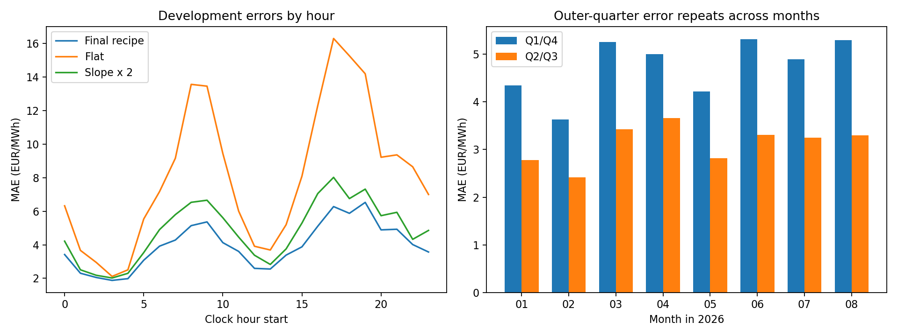

# Do the September error patterns repeat in development?

**Afternoon errors are higher than other hours in 8/8 folds;
Q1/Q4 errors are higher than Q2/Q3 in 8/8 folds.**
Yes: steep-ramp amplitude underestimation repeats in every fold.

This run replays the unchanged final recipe on eight rolling-origin January–August 2026 folds,
scoring day 19 through each month-end: **98 dates, 37,632 predictions**.
Each temporary fold model is fitted only through the previous month-end. Weights are fixed
within the fold; historical quarter prices are sliced strictly before each predicted date.
No September or October observations enter the computations. Both original artifact directories
were checked by SHA-256 and remain unchanged. Fold models were used in memory, not saved over artifacts.

## Score and repeatability

Official-style final-recipe MAE: **3.9479 EUR/MWh**, versus flat
**8.1276**, PCHIP **5.6185**, and fixed slope × 2
**4.8322**. Runtime versions are recorded in `summary.json`; they differ from
the original training environment, so small discrepancies from published scores are possible.

16:00–20:00 contributes **25.1%** of total error from 16.7% of observations.
Q1/Q4 contribute **60.3%** from 50% of observations.
The table below checks each month rather than relying only on the pooled result.

| fold | MAE | afternoon_MAE | other_hours_MAE | afternoon_error_share_pct | outer_MAE | middle_MAE | outer_error_share_pct |
| --- | --- | --- | --- | --- | --- | --- | --- |
| m2026_01 | 3.563 | 4.855 | 3.305 | 22.707 | 4.349 | 2.777 | 61.027 |
| m2026_02 | 3.024 | 3.882 | 2.852 | 21.396 | 3.629 | 2.418 | 60.010 |
| m2026_03 | 4.342 | 6.171 | 3.976 | 23.688 | 5.255 | 3.430 | 60.509 |
| m2026_04 | 4.328 | 5.350 | 4.123 | 20.605 | 4.998 | 3.657 | 57.747 |
| m2026_05 | 3.520 | 5.991 | 3.026 | 28.365 | 4.220 | 2.821 | 59.934 |
| m2026_06 | 4.313 | 7.754 | 3.625 | 29.961 | 5.319 | 3.308 | 61.653 |
| m2026_07 | 4.073 | 6.833 | 3.521 | 27.962 | 4.891 | 3.254 | 60.051 |
| m2026_08 | 4.295 | 6.372 | 3.879 | 24.727 | 5.292 | 3.298 | 61.609 |

## Does the model underestimate ramp amplitude?

“Steep” means absolute central hourly slope exceeds that zone's training-fold 75th percentile;
the day edges use a one-sided slope. The cutoff is fitted on training inputs only, not chosen
from evaluation outcomes. Its exact values are in `training_regime_thresholds.csv`.

- Range bias = predicted quarter max-minus-min minus observed quarter max-minus-min.
  Negative means too narrow. This diagnostic is meaningful but expected uncertainty can make
  a conditional-median prediction narrower than realized extremes, even for a well-chosen MAE model.
- Oriented tilt error = `(predicted Q4-Q1 - observed Q4-Q1) * sign(hourly slope)`.
  Negative means too little net tilt in the hourly ramp direction on average. Unlike an absolute
  range, this tests a signed direction. It still is not proof that a global amplitude increase lowers MAE.

| fold | steep_range_bias | other_range_bias | steep_oriented_tilt_error |
| --- | --- | --- | --- |
| m2026_01 | -7.516 | -3.550 | -5.465 |
| m2026_02 | -3.380 | -3.266 | -2.133 |
| m2026_03 | -2.284 | -4.627 | -1.176 |
| m2026_04 | -2.775 | -4.973 | -1.345 |
| m2026_05 | -2.178 | -2.947 | -1.493 |
| m2026_06 | -8.283 | -3.274 | -6.893 |
| m2026_07 | -3.392 | -3.581 | -1.924 |
| m2026_08 | -6.035 | -4.602 | -4.651 |

Range is underestimated on steep ramps in **8/8 folds**;
directional tilt is underestimated in **8/8**.
Each statistic is averaged over hours (repeating it for four quarters leaves the mean unchanged).

| steep_ramp | predictions | model_MAE | flat_MAE | pchip_MAE | slope2_MAE | error_share_pct | range_bias | oriented_tilt_error |
| --- | --- | --- | --- | --- | --- | --- | --- | --- |
| False | 23320.000 | 2.811 | 4.296 | 3.556 | 3.344 | 44.129 | -3.833 | -1.077 |
| True | 14312.000 | 5.800 | 14.370 | 8.979 | 7.258 | 55.871 | -4.322 | -3.013 |

## Zone differences

| market_id | predictions | model_MAE | flat_MAE | pchip_MAE | slope2_MAE | error_share_pct |
| --- | --- | --- | --- | --- | --- | --- |
| ZONE_0 | 9408.000 | 3.077 | 8.681 | 5.224 | 3.961 | 19.484 |
| ZONE_1 | 9408.000 | 4.624 | 10.151 | 7.087 | 5.757 | 29.282 |
| ZONE_2 | 9408.000 | 3.702 | 5.849 | 4.497 | 4.314 | 23.444 |
| ZONE_3 | 9408.000 | 4.389 | 7.830 | 5.666 | 5.297 | 27.790 |

| market_id | steep_ramp | model_MAE | range_bias | oriented_tilt_error |
| --- | --- | --- | --- | --- |
| ZONE_0 | False | 1.811 | -1.680 | -0.758 |
| ZONE_0 | True | 4.912 | -2.671 | -2.508 |
| ZONE_1 | False | 3.113 | -3.953 | -1.319 |
| ZONE_1 | True | 6.989 | -7.373 | -6.186 |
| ZONE_2 | False | 2.906 | -3.947 | -0.953 |
| ZONE_2 | True | 5.012 | -0.924 | 0.876 |
| ZONE_3 | False | 3.344 | -5.559 | -1.259 |
| ZONE_3 | True | 6.369 | -6.548 | -4.285 |

**Important zone exception:** ZONE_1's steep-ramp oriented tilt error is **−6.19 EUR/MWh**, versus **+0.88** for ZONE_2. ZONE_2 can have a range that is too narrow while its net Q4-minus-Q1 tilt is too large: these measure different aspects of shape. Prioritize ZONE_1/ZONE_3 for amplitude investigation, and do not amplify every zone uniformly.

Use this table to distinguish a shared amplitude issue from a zone-specific one. Pooled data can
hide opposite signs. A high absolute error is also partly a consequence of a more variable target.

## Turning points versus ramps

| geometry | predictions | model_MAE | flat_MAE | pchip_MAE | slope2_MAE | error_share_pct |
| --- | --- | --- | --- | --- | --- | --- |
| day edge | 3136.000 | 3.494 | 6.661 | 4.749 | 4.536 | 7.376 |
| ramp/plateau transition | 25856.000 | 4.050 | 9.250 | 6.029 | 4.944 | 70.483 |
| turning point | 8640.000 | 3.807 | 5.301 | 4.707 | 4.606 | 22.141 |

Turning points use opposite-signed backward/forward hourly differences; day edges are separate.
The remainder includes ramps and plateau transitions. These coarse groups mix hours and zones,
so conditional comparisons do not establish causality. Check `errors_by_zone_quarter.csv` and
`errors_by_fold_hour.csv` for more detail.

## Recommended next experiment, without claiming an improvement yet

1. Prioritize the weaknesses that repeat across months, using these summaries rather than a single
   September extreme. Inspect zone-specific signs before assuming every ramp needs more amplitude.
2. Test one small feature family: explicit local absolute movement and ramp asymmetry/reversal flags.
   Existing slopes and curvature already encode much of this; require incremental price-MAE gain.
3. If testing coefficient scales, estimate a small, regularized set on earlier development predictions
   and confirm on later months. Do not tune a scale on the same errors used to report its performance.
   The incumbent's 0.8 applies only to its learned correction, not to its full intra-hour shape.
4. Preserve the existing promotion gate: >=0.5% lower MAE, improvement on >=6/8 folds, no zone >2% worse.
   No candidate feature set or amplitude change was trained or selected in this diagnostic run.

These development folds have already supported model selection, and this investigation follows
September findings. Repetition is evidence of a recurring failure pattern, not independent final-test
confirmation. The attainable improvement remains unknown until a separately evaluated candidate wins.

## Files and reproduction

- `all_development_predictions.csv`: every prediction and observed value with fold cutoff and baseline errors.
- `fold_pattern_checks.csv`: the monthly comparisons above; `hourly_shape_diagnostics.csv`: per-hour amplitudes.
- `errors_by_*.csv`: zone, quarter, hour, geometry, steepness, and fold-specific summaries.
- `summary.json`: scores, runtime versions, configuration, cutoff checks, and unchanged-artifact hashes.
- Run from ApplePi: `.venv-mae/bin/python analysis/check_development_errors.py`.
