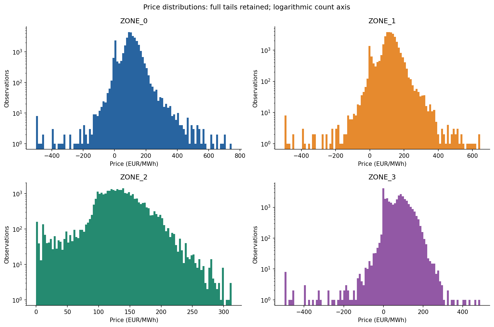
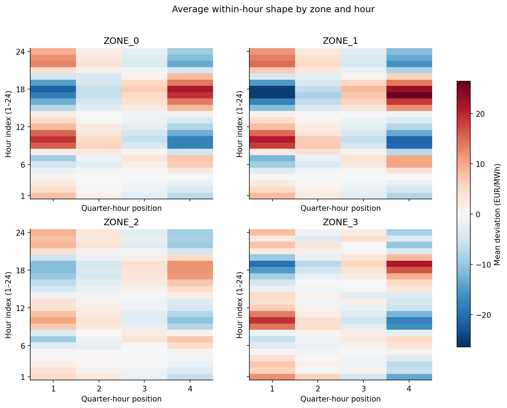
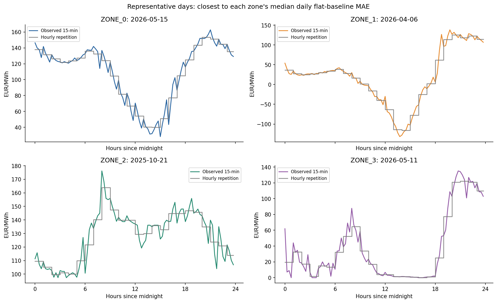
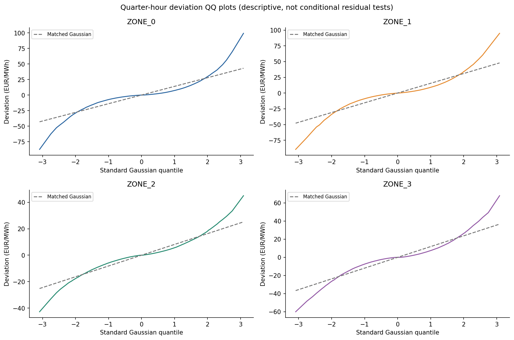
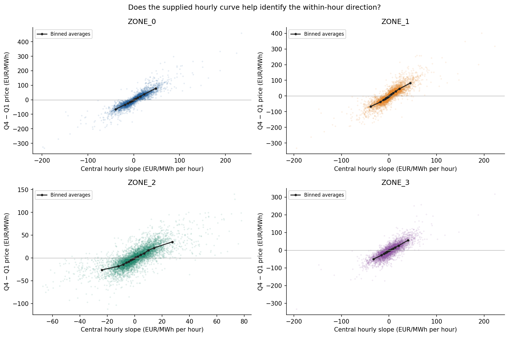
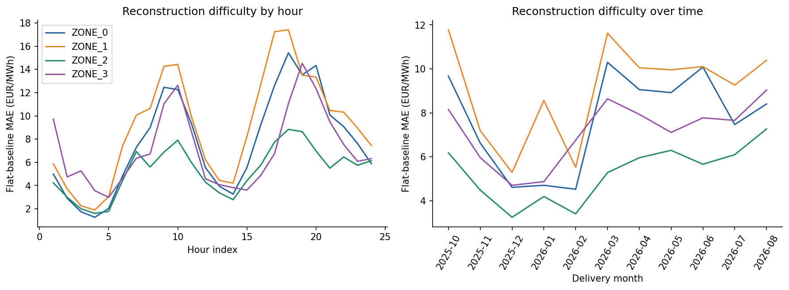

# Initial AET price analysis

Generated by `analysis/initial_analysis.py` from the official local CSV only.

## Scope and data quality

The complete file contains 139,392 observations, four zones and 363 dates per zone.
The exact expected observation grid passes: no missing keys, duplicate keys, missing values or non-finite prices.
The excluded dates are 2025-10-26 and 2026-03-29. Hours use the supplied CET/CEST delivery-date convention.

**All price statistics and plots below cover 2025-10-01 through 2026-08-31 only**
(333 days per zone). September prices are excluded from exploratory analysis.
Full-file structural checks do not constitute a model evaluation.

## Main findings

- The hourly central slope and Q4-minus-Q1 price difference have correlations from
  **0.755 to 0.909** across zones. This supports testing slope features.
- Copying yesterday's deviations improves on hourly repetition in all four zones on matched
  available historical rows. Weekly lags are not uniformly better than the flat baseline.
- Mean shapes differ by hour and zone; the heatmaps expose rising and falling within-hour patterns.
- Pooled deviations have heavier tails than the matched Gaussian in the QQ plots.
  This does not determine the likelihood of a future conditional model.

These are exploratory findings over the development period, not claims of held-out model accuracy.

## Price levels and flat baseline

| market_id | days | min_price | max_price | negative_pct | flat_mae |
| --- | --- | --- | --- | --- | --- |
| ZONE_0 | 333.000 | -499.990 | 747.100 | 5.843 | 7.675 |
| ZONE_1 | 333.000 | -498.650 | 645.200 | 3.047 | 9.082 |
| ZONE_2 | 333.000 | 0.000 | 313.000 | 0.000 | 5.291 |
| ZONE_3 | 333.000 | -498.650 | 487.380 | 6.575 | 7.139 |

Prices and MAE are in EUR/MWh; negative_pct is a percentage. The equal-zone flat-baseline MAE
over this exploratory period is **7.2967 EUR/MWh**. This is a descriptive baseline, not a
held-out result for a fitted model. No predictive model has been trained by this script.

## Within-hour shapes and tails

The reconstruction target is `deviation = quarter_hour_price - hourly_average`.
Its four values sum to zero within every hour. Inspect patterns by hour rather than relying
on a single daily-average shape: rising and falling hours can cancel.

Representative dates are selected automatically as the date closest to each zone's median daily
flat-baseline MAE. They are not selected for visual impact or model performance.

The QQ plots and skew/kurtosis in `tables/zone_summary.csv` describe pooled deviations.
They do not establish the distribution of errors conditional on future model inputs.
No independent-observation normality-test p-values are reported because these time series are dependent.
Keep negative prices and extremes; do not infer market price caps from observed extrema.

## Hourly curve and calendar lags

| market_id | slope_vs_q4_minus_q1_correlation |
| --- | --- |
| ZONE_0 | 0.909 |
| ZONE_1 | 0.864 |
| ZONE_2 | 0.755 |
| ZONE_3 | 0.820 |

The central slope uses previous and next hours of the supplied same-day hourly curve.
Boundary hours are excluded from this diagnostic, not from the dataset. Correlation is descriptive,
not proof of predictive improvement or a causal explanation.

| market_id | calendar_lag_days | availability_pct | deviation_correlation | copy_shape_mae_when_available | flat_mae_on_same_available_rows |
| --- | --- | --- | --- | --- | --- |
| ZONE_0 | 1.000 | 99.099 | 0.657 | 6.204 | 7.654 |
| ZONE_1 | 1.000 | 99.099 | 0.658 | 7.426 | 9.055 |
| ZONE_2 | 1.000 | 99.099 | 0.629 | 4.662 | 5.283 |
| ZONE_3 | 1.000 | 99.099 | 0.553 | 6.988 | 7.120 |
| ZONE_0 | 7.000 | 97.297 | 0.564 | 6.870 | 7.659 |
| ZONE_1 | 7.000 | 97.297 | 0.593 | 7.911 | 9.005 |
| ZONE_2 | 7.000 | 97.297 | 0.586 | 4.838 | 5.257 |
| ZONE_3 | 7.000 | 97.297 | 0.483 | 7.573 | 7.127 |

Lag availability includes start-of-file gaps and excluded DST dates. Joins use exact calendar dates,
zone, hour and quarter. Copy-shape and flat MAEs are compared on the same available rows;
these are historical diagnostics, not selected-model test results.

## Illustrative business consequence

| market_id | early_1MWh_mean_absolute_error_EUR | late_1MWh_mean_absolute_error_EUR |
| --- | --- | --- |
| ZONE_0 | 11.479 | 11.373 |
| ZONE_1 | 13.191 | 13.356 |
| ZONE_2 | 7.181 | 7.400 |
| ZONE_3 | 9.952 | 10.111 |

Each example delivers 1 MWh in the first or fourth quarter of an hour and zero elsewhere.
Values are mean absolute per-hour valuation errors in EUR under hourly repetition.
They are an interpretation of quarter-specific price errors, not trading profit or actual AET exposure.
Equal energy in every quarter would have zero valuation error by hourly-average consistency.

## Next implementation steps

1. Train hourly shape templates on October–June, then evaluate on July–August.
2. Compare a compact CatBoost model using zone/calendar, hourly slopes and exact historical lags.
3. Centre each four-quarter prediction; score only the final constrained output.
4. Keep September for one final chronological assessment; do not tune on it.
5. Freeze missing-lag fallbacks and all inference rules before submission.

No external data, zone identification or evaluation-period lookups are used. Do not round hourly
averages or predictions to two decimals. `centre_predictions` is a reusable constraint helper;
an eventual submission must additionally validate keys, finiteness and averages after CSV round-trip.
