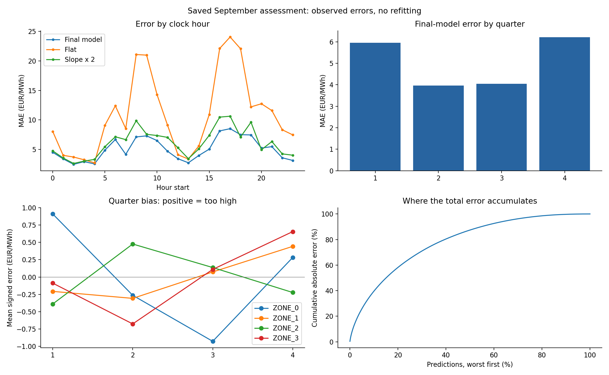
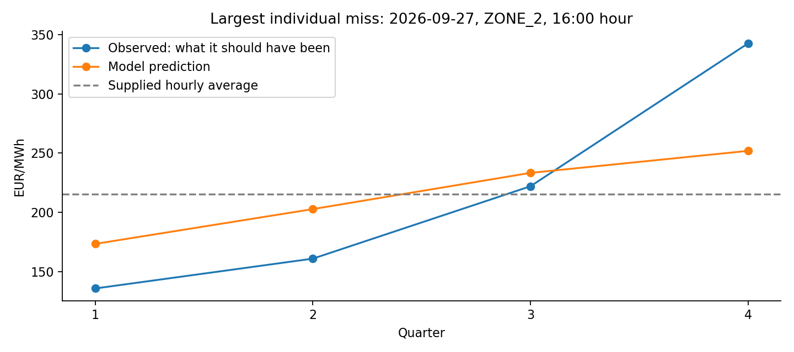

# Error analysis: prediction versus what was observed

**Every one of the 4,608 predictions is compared with its observed quarter price.**
Source: saved assessment on 19–30 September 2026; model weights trained through August.
No model was retrained or changed. This is diagnosis of the existing results, not new validation
and not a recommendation to tune on September.

Open [the prediction explorer](prediction_explorer.html) to filter by date/zone, sort the errors,
and inspect 100 rows at a time. [Download all rows](all_predictions_vs_actual.csv).
“Observed” is what the price should have been; “predicted” is what the model returned.
Signed error = predicted minus observed; positive means too high. Absolute error ignores direction.
All price and error values below are EUR/MWh. Clock hours use 00–23, unlike dataset hour indices 1–24.

## Main findings and what they change

- **Afternoon ramps deserve attention:** 16:00–20:00 accounts for **26.1%** of total
  error, despite containing only 16.7% of observations. The highest-MAE hour starts at 17:00.
- **Outer quarters remain important:** Q1 and Q4 together contribute **60.3%**
  of total error from half the observations. Yet their improvement over flat is larger than
  that of the middle quarters; high remaining error does not mean the model adds no value there.
- **ZONE_1 and ZONE_2 contribute 58.3%** of total error. ZONE_1 is the larger contributor;
  ZONE_2 is interesting because its reconstruction gain is smaller, not because it contributes most error.
- **Turning points are not the highest-error geometry group:** their MAE is 5.001 versus 5.207
  for ramps/plateau transitions. However, flat is much stronger at reversals, so the model's relative
  gain is smaller there. Inspect both error contribution and gain over baseline before prioritizing.
- **The largest miss is an underestimated late-quarter surge:** on 2026-09-27,
  ZONE_2 at 16:45, the model gives **251.93** instead of
  **342.53**, an error of **90.60**. The other quarters of that
  hour show compensating overestimates. This is a shape/amplitude mismatch, not a wrong hourly level.
- **The slope rule is not beaten in every clock-hour group:** slope × 2 has lower mean error
  at hour starts **18:00, 20:00** in this sample. This does not authorize
  switching models at those times based on September; first test that pattern on development folds.

## 1. How large are the misses?

- Mean absolute error: **5.044**; median absolute error: **3.037**.
- 90th / 95th percentile error: **11.639 / 16.680**.
- Within 5 EUR/MWh: **66.7%**; within 10: **86.7%**; within 20: **96.7%**.
- Largest individual error: **90.597**.
- The worst 5% of predictions account for **25.9%** of all absolute error.
- The model beats flat on **12/12** daily equal-zone averages.

The mean is not the error of every prediction. The tail and error contribution show whether
improving a small set of difficult observations could matter. Error share means sum of absolute
errors in that group divided by the total; the groups must be disjoint to sum to 100%.

## 2. Zone by zone, on exactly the same observations

| market_id | model_MAE | flat_MAE | pchip_MAE | slope2_MAE | error_share_pct |
| --- | --- | --- | --- | --- | --- |
| ZONE_0 | 3.859 | 10.784 | 5.728 | 4.752 | 19.127 |
| ZONE_1 | 6.258 | 13.302 | 8.581 | 7.515 | 31.014 |
| ZONE_2 | 5.506 | 9.723 | 7.487 | 6.370 | 27.290 |
| ZONE_3 | 4.554 | 9.786 | 5.912 | 5.798 | 22.569 |

Compare both conditional MAE and error share. A high-error zone has more room to improve, but
the baseline comparisons show how much shape uncertainty was present in that zone already.
ZONE_2's weaker full-year slope relation is a hypothesis to investigate on development data;
this September ranking alone cannot establish a general defect or justify a separate model.

## 3. Quarter by quarter: direction as well as size

| quarter_index | predictions | model_MAE | flat_MAE | error_share_pct | signed_bias |
| --- | --- | --- | --- | --- | --- |
| 1.000 | 1152.000 | 5.960 | 15.601 | 29.538 | 0.056 |
| 2.000 | 1152.000 | 3.967 | 6.046 | 19.661 | -0.193 |
| 3.000 | 1152.000 | 4.042 | 5.813 | 20.034 | -0.152 |
| 4.000 | 1152.000 | 6.208 | 16.135 | 30.767 | 0.289 |

Signed bias across all four quarters cancels because both observed and predicted prices share
the same hourly average. Therefore near-zero overall bias does not mean accurate predictions.
Inspect Q1/Q4 biases by zone in [errors_by_zone_quarter.csv](errors_by_zone_quarter.csv), and
do not infer universal underprediction or overprediction from the overall mean signed error.

## 4. Which hours account for most error?

| hour_start | predictions | model_MAE | flat_MAE | error_share_pct |
| --- | --- | --- | --- | --- |
| 17.000 | 192.000 | 8.506 | 24.066 | 7.026 |
| 16.000 | 192.000 | 8.130 | 22.123 | 6.716 |
| 18.000 | 192.000 | 7.491 | 22.071 | 6.187 |
| 19.000 | 192.000 | 7.445 | 12.209 | 6.150 |
| 9.000 | 192.000 | 7.289 | 20.989 | 6.021 |

Lowest-MAE clock hours in this sample:

| hour_start | model_MAE | flat_MAE |
| --- | --- | --- |
| 2.000 | 2.451 | 3.693 |
| 4.000 | 2.532 | 2.704 |
| 13.000 | 2.722 | 3.348 |

The complete [24-hour breakdown](errors_by_hour.csv) includes PCHIP and slope × 2 comparisons.
Use the final model's remaining errors, rather than assuming that every weakness of the EDA's
simple slope rule remains a weakness of the learned correction.

## 5. Turning points, ramps, and day boundaries

| geometry | predictions | model_MAE | flat_MAE | error_share_pct |
| --- | --- | --- | --- | --- |
| day edge | 384.000 | 3.810 | 7.748 | 6.295 |
| ramp or plateau transition | 3184.000 | 5.207 | 12.418 | 71.327 |
| turning point | 1040.000 | 5.001 | 7.411 | 22.378 |

A turning point has opposite signs for backward and forward hourly changes. Day edges are
classified separately because a same-day neighbor is missing. “Ramp or plateau transition”
includes same-direction changes and hours with one flat neighbor; no fitted threshold is used.
These are input-derived labels, not actual-quarter extremes. Differences can reflect different
zone/hour compositions rather than a causal effect of geometry. See [zone/hour details](errors_by_zone_hour.csv).

Time-window comparison:

| period | predictions | model_MAE | flat_MAE | error_share_pct |
| --- | --- | --- | --- | --- |
| afternoon/evening 15-22 | 1344.000 | 6.755 | 16.529 | 39.056 |
| midday 11-15 | 768.000 | 3.691 | 5.529 | 12.195 |
| morning 06-11 | 960.000 | 6.339 | 15.450 | 26.180 |
| night 22-06 | 1536.000 | 3.415 | 5.813 | 22.569 |

## 6. Date by date

| delivery_date | model_MAE | flat_MAE | pchip_MAE | slope2_MAE | error_share_pct |
| --- | --- | --- | --- | --- | --- |
| 2026-09-19 00:00:00 | 4.629 | 9.207 | 6.226 | 5.859 | 7.647 |
| 2026-09-20 00:00:00 | 4.677 | 8.460 | 6.299 | 5.630 | 7.726 |
| 2026-09-21 00:00:00 | 6.144 | 13.104 | 8.847 | 7.570 | 10.150 |
| 2026-09-22 00:00:00 | 5.731 | 13.517 | 7.732 | 7.467 | 9.467 |
| 2026-09-23 00:00:00 | 5.626 | 12.606 | 7.951 | 6.268 | 9.294 |
| 2026-09-24 00:00:00 | 4.310 | 10.210 | 6.454 | 5.426 | 7.121 |
| 2026-09-25 00:00:00 | 4.526 | 10.604 | 6.432 | 5.323 | 7.476 |
| 2026-09-26 00:00:00 | 4.581 | 9.685 | 5.666 | 5.771 | 7.568 |
| 2026-09-27 00:00:00 | 4.350 | 9.476 | 6.212 | 5.619 | 7.186 |
| 2026-09-28 00:00:00 | 5.292 | 12.624 | 7.612 | 6.715 | 8.742 |
| 2026-09-29 00:00:00 | 4.663 | 9.316 | 5.744 | 5.218 | 7.703 |
| 2026-09-30 00:00:00 | 6.004 | 11.977 | 7.946 | 6.439 | 9.919 |

See [all 48 date/zone results](errors_by_date_zone.csv) to separate a difficult day across markets
from a problem isolated to one zone. September contains only 12 scored dates.

## 7. Largest misses: actual versus predicted, one by one

| delivery_date | market_id | time | quarter_index | price_eur_mwh | predicted_price_eur_mwh | signed_error | absolute_error |
| --- | --- | --- | --- | --- | --- | --- | --- |
| 2026-09-27 00:00:00 | ZONE_2 | 16:45 | 4.000 | 342.530 | 251.933 | -90.597 | 90.597 |
| 2026-09-22 00:00:00 | ZONE_0 | 19:45 | 4.000 | 533.260 | 608.667 | 75.407 | 75.407 |
| 2026-09-28 00:00:00 | ZONE_1 | 10:30 | 3.000 | 44.450 | 117.949 | 73.499 | 73.499 |
| 2026-09-20 00:00:00 | ZONE_1 | 08:00 | 1.000 | 165.980 | 100.657 | -65.323 | 65.323 |
| 2026-09-19 00:00:00 | ZONE_1 | 08:45 | 4.000 | 19.040 | 81.811 | 62.771 | 62.771 |
| 2026-09-22 00:00:00 | ZONE_1 | 19:45 | 4.000 | 477.970 | 536.252 | 58.282 | 58.282 |
| 2026-09-21 00:00:00 | ZONE_1 | 16:00 | 1.000 | 72.700 | 127.719 | 55.019 | 55.019 |
| 2026-09-28 00:00:00 | ZONE_1 | 10:00 | 1.000 | 225.990 | 171.669 | -54.321 | 54.321 |
| 2026-09-20 00:00:00 | ZONE_1 | 16:45 | 4.000 | 198.170 | 145.747 | -52.423 | 52.423 |
| 2026-09-28 00:00:00 | ZONE_1 | 10:15 | 2.000 | 210.020 | 157.796 | -52.224 | 52.224 |
| 2026-09-28 00:00:00 | ZONE_1 | 09:00 | 1.000 | 255.750 | 208.292 | -47.458 | 47.458 |
| 2026-09-26 00:00:00 | ZONE_2 | 08:00 | 1.000 | 262.080 | 214.654 | -47.426 | 47.426 |

Columns `price_eur_mwh` and `predicted_price_eur_mwh` mean observed and predicted respectively.
[Full top 50](worst_50_predictions.csv) also includes each baseline's absolute error.
A large miss is not automatically a model failure relative to an available alternative.

### The hour containing the single largest miss

| time | quarter_index | price_eur_mwh | predicted_price_eur_mwh | signed_error | absolute_error |
| --- | --- | --- | --- | --- | --- |
| 16:00 | 1.000 | 136.000 | 173.553 | 37.553 | 37.553 |
| 16:15 | 2.000 | 161.120 | 202.878 | 41.758 | 41.758 |
| 16:30 | 3.000 | 222.110 | 233.396 | 11.286 | 11.286 |
| 16:45 | 4.000 | 342.530 | 251.933 | -90.597 | 90.597 |

Both curves preserve the same supplied hourly mean, but distribute that value differently
across quarters. The chart makes the actual shape mismatch visible without hiding the other
three quarters. It cannot by itself identify why the learned model produced that shape.

Across all hours, predicted range minus observed range averages **-1.570**.
Negative means the predicted max-minus-min range is too narrow on average; positive means too wide.
Inspect [hourly_shape_errors.csv](hourly_shape_errors.csv) before concluding that all regimes
need more amplitude. Averages can mix underestimation on volatile hours and overestimation on calm hours.

## 8. What to do next with these findings

1. Reproduce the leading hour/zone/geometry concentrations on January–August rolling-origin
   development predictions. These September observations are retrospective evidence only.
2. If reversals are consistently costly, test explicit peak/valley flags and local absolute
   movement against the incumbent. Curvature and slopes already exist, so require incremental gain.
3. If repeated Q1/Q4 and range biases persist within a zone, test limited zone/component scaling
   on development data. Do not change the 0.8 scale solely to repair this September sample.
4. If flat or slope × 2 wins only on isolated observations, do not route predictions using realized
   target errors. Any gate must use available hourly/history features and work on later dates.
5. Keep rare extreme cases and their sample counts visible. Some quarter shapes cannot be uniquely
   recovered from hourly averages; a visually plausible reconstruction can still miss an observed extreme.

## Files and reproducibility

- [Interactive row explorer](prediction_explorer.html), [all prediction comparisons](all_predictions_vs_actual.csv), [worst 50](worst_50_predictions.csv).
- CSV summaries by zone, quarter, clock hour, date, date/zone, zone/quarter, zone/hour, geometry, and period.
- `summary.json` contains tail statistics. `hourly_shape_errors.csv` contains observed and predicted ranges.
- Rerun from ApplePi: `.venv-mae/bin/python analysis/analyze_saved_errors.py --source analysis/results/mae_evaluation_20261017_175448`.
- Checks verify row uniqueness, agreement with the saved truth and prediction files, score reproduction,
  and hourly-average consistency. Observed quarter prices are used for diagnostics only.
